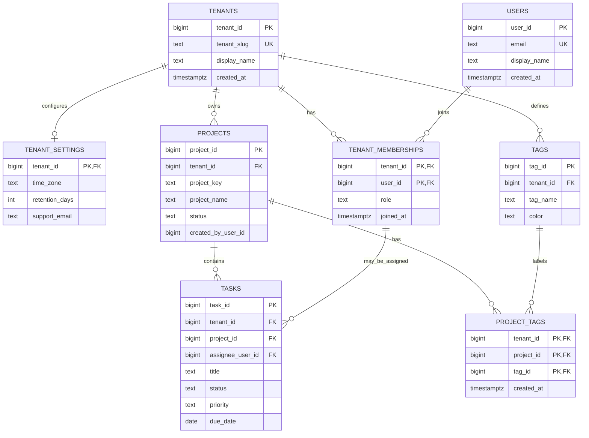

# ER Diagram

Render the Mermaid block below in GitHub Markdown or paste it into the [Mermaid Live Editor](https://mermaid.live/) to export an image.

## Relationship summary

- **1:1:** each tenant can have zero or one settings row; `tenant_settings.tenant_id` is both primary key and foreign key, so duplicate settings for a tenant are impossible.
- **1:N:** one tenant owns many projects; one project contains many tasks; one tenant defines many tags.
- **N:M:** users can join multiple tenants, and tenants can have multiple users through `tenant_memberships`. Projects can use multiple tags, and tags can be applied to multiple projects through `project_tags`.
- **Tenant-safe references:** composite foreign keys include `tenant_id`, so a project cannot be linked to a tag or assignee from another tenant.
